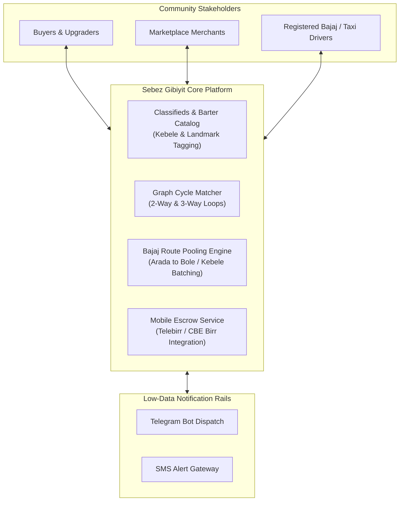

# Project Proposal: Sebez Market
### *Smart Circular Barter & Hyperlocal Pooled Marketplace for Ethiopian Urban Centers*

---

## 1. Brand Identity & The Philosophy Behind "Sebez" (ሰበዝ)

### 1.1 The Cultural Origin & Meaning
In Ethiopian traditional craft, **ሰበዝ** (*Sebez*) is the resilient, flexible straw fiber harvested from nature. By itself, a single strand of *sebez* is delicate and limited in what it can bear. However, when skilled Ethiopian hands weave hundreds of *sebez* strands together in an intricate circular spiral, it creates a **ሰፌድ** (*Sefed*)—the indispensable, strong, heat-resistant traditional tray used in every household to lift fresh, hot *Injera* directly from the **ምጣድ** (*Mitad*).

Without the *sefed*, handling the staple of Ethiopian life (*injera*) right off the searing *mitad* is impossible; and without individual strands of *sebez* bound together, a *sefed* cannot exist.

```
      [ Single Strand of Sebez ]           ==>   Fragile, isolated, limited utility
                  │
        (Interwoven in Harmony)
                  │
                  ▼
         [ Traditional Sefed ]             ==>   Strong, resilient, circular, lifts Injera from Mitad
                  │
        (Platform Parallel)
                  │
                  ▼
 [ Sebez Gibiyit (ሰበዝ ግብይት) Platform ]  ==>   Weaves individual traders & Bajaj drivers into an unbroken circle of commerce
```

### 1.2 Why "Sebez" Was Chosen for This Platform
This platform was named **Sebez Gibiyit (ሰበዝ ግብይት)** because it is the exact digital embodiment of this traditional craftsmanship:

1. **The Circular Barter Parallel:** 
   An individual person trapped with a device they cannot sell for cash is like a single strand of *sebez*—isolated and stuck. But when our matching algorithm connects Person 1 to Person 2 and Person 3 in a continuous, closed-loop 3-way circular trade ($A \to B \to C \to A$), it weaves those separate desires into a complete, self-sustaining circle—just like weaving a *sefed*.
2. **The Hyperlocal Pooled Logistics Parallel:**
   Ten different residents in Bole or Kebele 04 who each need items from Arada Market would traditionally waste money and fuel taking ten separate Bajaj rides. Like strands of *sebez* woven together, **Sebez Gibiyit** weaves these separate orders into a single coordinated Bajaj delivery run, saving money for the families and providing reliable income for the driver.
3. **Brand Motto & Tagline:**
   > **ሰበዝ ግብይት (Sebez Market)**: *“እንደ ሰበዝ ተሳስረን፣ ግብይቱን እናቀላጥፋለን!”*  
   > *(Interwoven like Sebez, empowering trade and community!)*

---

## 2. Executive Summary & Problem Statement

Traditional classifieds marketplaces (such as Jiji, Facebook Marketplace, and informal Telegram channels) in Ethiopian cities like Adama, Hawassa, and Addis Ababa face two crippling structural bottlenecks:

1. **The Liquidity & Asset Trapping Problem:** 
   Due to inflation and cash shortages, converting high-value items (smartphones, laptops, home electronics) into liquid cash first takes weeks of frustrating negotiations and lowball offers. Users who simply want to upgrade their device must complete two separate, risky transactions: *sell item for cash $\to$ add cash $\to$ buy target item*.
2. **The Hyperlocal Transport & Last-Mile Friction:**
   In cities like Adama, central commercial districts (e.g., Arada Kebele, Amede/Geda Market) hold the inventory that peripheral residential kebeles (e.g., Bole, Kebele 04, Posta Bet) need daily. Individual round-trip Bajaj fares (100–300 ETB) and travel times make shopping expensive and inefficient.

**Sebez Gibiyit (ሰበዝ ግብይት)** bridges this gap by introducing:
* **Algorithmic 2-Way & 3-Way Circular Barter Engine** with automated cash top-up balancing.
* **Hyperlocal Pooled Bajaj Logistics (Personal Shopper & Courier)** that batches kebele-to-kebele orders.
* **Telebirr & CBE Birr Mobile Escrow** with dual-OTP inspection verification.

---

## 3. System Architecture & Core Modules



---

## 4. Key Functional Innovations

### 4.1 Circular Barter & Cash Top-Up Engine
* **2-Way Swaps with Cash Difference:** If User 1 has an iPhone 13 Pro (estimated 55,000 ETB) and User 2 has a Samsung S21 (estimated 38,000 ETB), the platform calculates the fair value difference. User 2 deposits the 17,000 ETB cash top-up into platform escrow, completing the exchange smoothly.
* **3-Way Loop Detection (Graph Algorithm):** Using directed cycle-finding algorithms (Tarjan's/Johnson's algorithm), the platform identifies 3-party closed chains:
  - User A (has Laptop, wants iPhone)
  - User B (has iPhone, wants Camera)
  - User C (has Camera, wants Laptop)
  The platform notifies all three parties simultaneously to execute the triangular exchange.

### 4.2 Hyperlocal Pooled Bajaj Delivery (Personal Shopper Logistics)
* **Neighborhood Order Clustering:** Orders placed from central markets (Arada / Amede) bound for the same residential kebele (e.g., Bole) are batched into a single scheduled "Market Run".
* **Fare Splitting & Savings:** Instead of each customer paying 150 ETB for an individual Bajaj charter, 4 customers pay 45 ETB each. The customer saves 70%, while the driver earns 180 ETB in a single short run.
* **Solving the Dispersed (Worst-Case) Scenario:** When destinations are scattered across different kebeles, the system applies a nearest-neighbor multi-stop routing algorithm with distance-proportional cost splitting.

### 4.3 Mobile Escrow & Driver Verification (Telebirr / CBE Birr)
* Funds are safely held in digital escrow. Drivers do not risk out-of-pocket cash.
* **Dual-OTP Verification:**
  1. *Merchant Release OTP:* Driver inspects the item at the market, verifies specifications, and submits the Merchant OTP.
  2. *Buyer Delivery OTP:* Customer receives and tests the device at their door, then submits the Delivery OTP to release funds to the merchant and driver.

### 4.4 Driver Onboarding & KYC
* Drivers register with: Full Name, National ID / Kebele ID, Driver's License number, Bajaj plate number, and phone number.
* Once verified by the platform admin, drivers receive priority dispatch runs and earn performance trust ratings.

### 4.5 Telegram Bot & Low-Data Access
* A dedicated Telegram Bot pings drivers and buyers with instant alerts for new match proposals and dispatch pickups, ensuring full usability even on low-bandwidth mobile networks.

---

## 5. Technology Stack

| Layer | Chosen Technology | Justification |
| :--- | :--- | :--- |
| **Frontend Framework** | **Next.js 14+ (App Router), React, Tailwind CSS** | Blazing-fast performance, SEO indexing for classified listings, mobile-first responsive design. |
| **Languages & Localization** | **TypeScript, next-intl** | Type safety; native support for **Amharic (አማርኛ)**, **Afaan Oromoo**, and **English**. |
| **Database & ORM** | **PostgreSQL + Prisma ORM** | Reliable relational modeling for escrow, users, KYC, and recursive graph traversal queries. |
| **Payments & Escrow** | **Telebirr API / CBE Birr / Chapa** | Essential localized mobile payment rails for automated wallet funding and payout. |
| **Dispatch & Messaging** | **Telegram Bot API + Local SMS Webhook** | Low-data, real-time dispatch alerts for drivers and notifications for buyers. |

---

## 6. The 10-Day Git Commit & Development Roadmap

| Day | Milestone Focus | Commit Message |
| :--- | :--- | :--- |
| **Day 0** | **Project Charter & Proposal:** Documenting the Sebez philosophy, system architecture, and Ethiopian market strategy. | `docs: project charter, sebez cultural philosophy, and system architecture` |
| **Day 1** | **Core Scaffolding & Schema:** Next.js setup, Tailwind theme, Prisma schemas (User, Driver, Listing, TradeOffer, DeliveryPool). | `feat(core): initialize nextjs app, tailwind theme, and prisma relational schema` |
| **Day 2** | **Auth & Driver KYC:** Registration for Buyers, Merchants, and Bajaj Drivers with document upload and verification badges. | `feat(auth): implement role-based auth and driver onboarding kyc workflow` |
| **Day 3** | **Marketplace Listings with Barter Flags:** Classifieds feed with Kebele/Landmark filters, swap intent, and cash top-up tags. | `feat(listings): build product catalog with kebele tagging and swap intent flags` |
| **Day 4** | **Bilateral (2-Way) Swap Deal Room:** Interactive negotiation room with real-time cash difference calculations. | `feat(trades): build 2-way barter negotiation room with dynamic cash top-up calculator` |
| **Day 5** | **3-Way Circular Trade Matching Engine:** Graph cycle detection algorithm identifying closed triangular trade loops. | `feat(matching): implement 3-way circular trade loop graph matching engine` |
| **Day 6** | **Hyperlocal Pooled Bajaj Dispatch:** Kebele order grouping, scheduled market runs, and driver routing dashboard. | `feat(logistics): add hyperlocal pooled delivery engine and driver routing interface` |
| **Day 7** | **Telebirr & CBE Birr Mobile Escrow:** Escrow hold simulation, checkout flows, and dual-OTP delivery release. | `feat(escrow): implement telebirr escrow holds and dual-otp delivery handoff` |
| **Day 8** | **Telegram Bot & Low-Data Alerts:** Bot dispatch webhooks for instant match alerts and pickup routing. | `feat(notifications): add telegram bot dispatch alerts and sms notification webhooks` |
| **Day 9** | **Localization & Mobile PWA Polish:** Amharic and Afaan Oromoo language switcher, responsive mobile design. | `feat(i18n): add amharic and afaan oromoo localization and mobile polish` |
| **Day 10** | **Demo Seed Data & Production Ready:** Seed data for Adama markets (Arada, Bole, Amede), final testing, and deployment setup. | `docs: complete architecture docs, seed demo data for adama, and deployment config` |
